### Hey, I'm Chaitanya 👋

I came to data through physics. After my BSc and Master of Physics in Pune, I kept noticing that the part I enjoyed most wasn't the theory. It was working with the measurements: cleaning them up, plotting them, and reaching the moment where the numbers finally made sense.

So I followed that. In Melbourne I completed a **Master of Data Science at Deakin University (2026)**, and now I'm looking for my first role as a **junior data analyst or data scientist**.

**What I'm good at:** taking data that's messy, inconsistent or spread across files, and turning it into something a person can look at and make a decision from.

---

### Things I've built

#### 🔋 [Battery Electrochemical Data Analysis](https://github.com/Chaitanya932000/battery-analysis-project)
*my own project*

Battery tests (CV, GCD and EIS) export data in slightly different formats, and processing them by hand is slow and error-prone. I wrote a Python pipeline that reads every raw file, works out the messy column names itself, pulls out the key measurements and produces report-ready charts and tables in one run. Then I added a Streamlit dashboard so results can be explored without touching code.

Python · pandas · SciPy · Matplotlib · Streamlit

#### 🚆 [Melbourne Public Transport Chatbot](https://github.com/Chaitanya932000/melbourne-public-transport-chatbot)
*team project, Melbourne Open Data Playground*

A chatbot you can simply ask *"when's my next train?"*. I worked on the next-train finder using real timetable (GTFS) data, made it handle unknown stations and bad input gracefully, connected live transport updates, and improved the maps and chat interface.

Python · Rasa · GTFS · PTV API · HTML/JS

#### 🔥 [FireFusion](https://github.com/InnovAIte-Deakin/InnovAIte_FireFusion_Project)
*team project, InnovAIte at Deakin*

A large multi-team platform. I built two monitoring screens, the [misinformation monitor](https://github.com/InnovAIte-Deakin/InnovAIte_FireFusion_Project/pull/136) (merged) and the [alerts monitor](https://github.com/InnovAIte-Deakin/InnovAIte_FireFusion_Project/pull/127), working through branches, pull requests and code review with the team.

Front-end · Git workflow · Code review

---

### How I like to work

- **Check the data before trusting it.** Physics taught me that a strange result is usually a measurement problem first.
- **Automate the boring part.** If I'm doing something by hand twice, it becomes a script.
- **Explain it simply.** A chart someone understands beats a model nobody trusts.
- **Show up and get it done.** I've worked in Melbourne warehouse operations alongside my studies, where accuracy and deadlines aren't optional.

### My toolkit

`Python` `pandas` `NumPy` `SciPy` `Jupyter` `Excel` `Matplotlib` `Seaborn` `Streamlit` `Git` `GitHub Actions`

---

### Let's talk

I'm open to **junior data analyst, data science and reporting roles**, contract or permanent, in Melbourne or anywhere in Australia and New Zealand. If you're hiring or just want to talk data, I'd love to hear from you.

